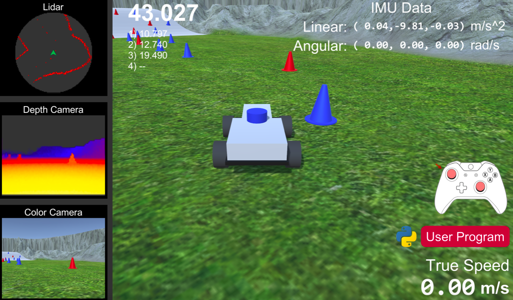

# Autonomous RACECAR: Sensor-Driven Control in Simulation

Python controllers for a simulated autonomous car (MIT Lincoln Laboratory RACECAR-MN, Unity simulator), using a color camera, depth camera, 2D LIDAR, IMU and AR markers.

## About

Done in Summer 2022 in the Autonomous Mini-Racecar (Robotics) Program by Learn with Leaders, in collaboration with the MIT Beaver Works Summer Institute (BWSI).


## Overview

The labs build up from open-loop driving to full multi-sensor autonomy. Early labs use HSV thresholding and contour analysis on the color camera for line following and cone parking, then adds depth-image processing for safety stops and wall alignment. Later labs use windowed LIDAR queries for obstacle avoidance and right-wall following, ArUco markers for navigation, and IMU data for roll limiting, heading-based maneuvers and a speed limiter that fuses IMU, LIDAR and depth range-rate with a complementary filter. The final programs combine these into time-trial and grand-prix drivers. Every controller follows the same pipeline:


``` sensors -> perception -> proportional control -> speed + angle ```

**Stack: Python, OpenCV, NumPy, Jupyter, RacecarSim (Unity)**

## Simulation Preview




## Structure
``` 
.
├── labs/
│   ├── lab1/ ... lab5/
│   ├── p1challenge/
│   ├── bonus1/  bonus2/
│   └── final/
├── library/
├── tests/
├── docs/
├── scripts/
├── LICENSE
└── README.md
```
